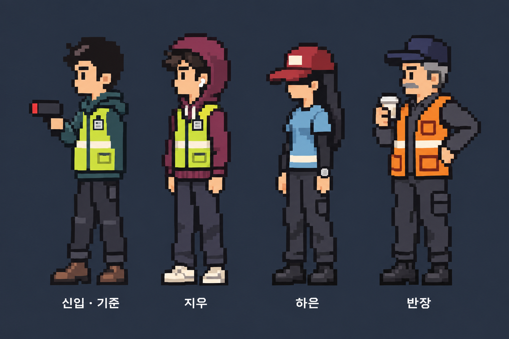

# 컷씬용 캐릭터 도트 디자인 · 신입 기준

컷씬 제작에 사용할 캐릭터 도트 디자인 자료다. 하은·지우·반장이 신입보다 고해상도 일러스트처럼 보인다는 피드백을 반영해, 신입의 큰 픽셀 덩어리와 계단형 윤곽, 간결한 얼굴과 명암을 기준으로 표현을 맞췄다.

왼쪽부터 신입, 지우, 하은, 반장이다. 지우의 버건디 후드와 형광 조끼, 하은의 빨간 모자·하늘색 작업복·손목시계, 반장의 남색 모자·회색 콧수염·주황 조끼를 유지한다.

이번 커밋에는 시안 이미지와 설명만 포함한다. 기존 승인 원화, 인게임 에셋과 리깅은 교체하지 않는다.
