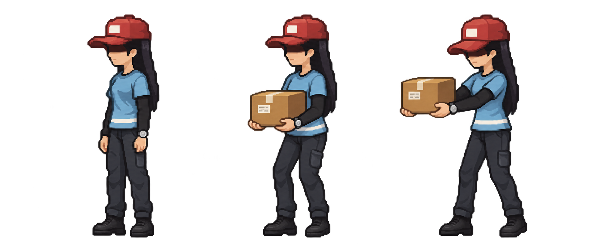

# 하은 캐릭터 디자인 시안

승인된 원본 시안을 보관하는 디자인 자료입니다. 이번 커밋에는 인게임 적용이나 리깅 변경을 포함하지 않습니다.

- 역할: 스캐너를 사용하지 않고 택배를 옮기는 작업자.
- 외형: 빨간 모자와 모자 아래로 가려진 눈, 긴 검은 머리.
- 복장: 하늘색 반팔 작업복, 검은 긴 소매, 흰색 밑단, 어두운 작업 바지와 부츠, 손목시계.
- 포즈: 왼쪽부터 대기, 택배 들기, 택배 건네기.
- 원본 파일: `haeun-concept.png` — 1944 × 809, 투명 배경 PNG. 승인된 디자인의 비율과 세부 표현을 그대로 유지합니다.

인게임 연결과 애니메이션은 별도 작업으로 진행합니다.
