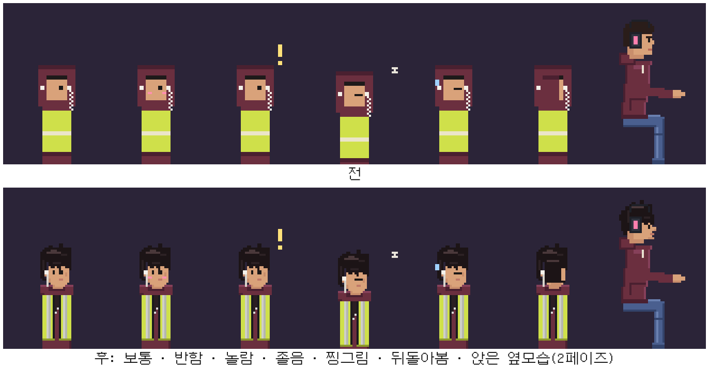

# 지우 — 그림 기준

레퍼런스 일러스트(위)를 게임 도트로 옮긴 기준. 코드는 `prototype/index.html`의 `PARTNERS.jiwoo.draw`(서 있는 지우, 모든 스테이지 공통)와 `drawJiwooSeated`(1-5 2페이즈, 책상에 앉은 옆모습).

- **머리**: 검은 머리(`#1c1416`, 결 `#2c2124`, 윤기 `#4a383a`). 정수리가 부스스하게 삐치고(위로 튀는 결 셋), 뒷머리가 목덜미까지, **앞머리가 눈썹을 덮고 몇 가닥이 눈까지** 내려온다.
- **얼굴**: 오른쪽으로 3/4 돌린 얼굴. 가까운 눈 2×2(표정은 `faceFx`: 졸음·찡그림·흘깃), 먼 눈 1×2, 코 그림자 한 점, 작은 입. 귀는 뒤쪽(왼쪽)에, 이어폰은 그 귀에 꽂고 줄이 목으로.
- **옷**: 자주색 후드티(`#6b2f3f`), **후드는 벗어서 목 둘레에 접혀 있음**. 형광 조끼는 **앞이 열려** 있고 가운데로 후드티와 끈(검은 끈, 은색 끝)이 보인다. 반사띠는 **세로 두 줄, 회색**(`#b4b6ae`), 조끼 안쪽 가장자리에 검은 테.
- **앉은 옆모습(2페이즈)**: 같은 머리 모양을 옆에서. 집이라 조끼는 의자 등받이에 걸어 두고 후드티와 청바지, 슬리퍼, 헤드폰.

이전 도트는 후드를 머리까지 쓴 모습이었다(위 줄).
